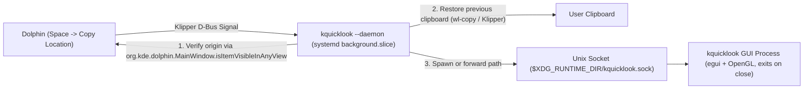

# KQuickLook

[](https://github.com/Arda-Aras103/kquicklook/actions/workflows/ci.yml)
[](LICENSE)

**KQuickLook** is a low-memory, single-instance file preview utility written in Rust (`egui`/`eframe`) that brings macOS QuickLook (`Space` to preview) to KDE Plasma and Dolphin on Wayland and X11.

<!-- Demo preview placeholder: Place your recorded recording into assets/demo.gif -->
<!--  -->

## Architecture & Data Flow



- **Preview window** (`kquicklook <file>`): Runs only while open and exits completely when closed with `Space`/`Esc`. Invoking `kquicklook` on another file while open updates the existing window via `$XDG_RUNTIME_DIR/kquicklook.sock`.
- **Dolphin Spacebar bridge** (`kquicklook --daemon`): Listens to Klipper D-Bus signals via `busctl --json=short monitor` without initializing a GUI or OpenGL context (~2–3 MB RAM in `background.slice`, 0% idle CPU). When `Space` triggers "Copy Location" in Dolphin, it verifies the path came from an active Dolphin view (`isItemVisibleInAnyView`), opens the preview, and restores the previous clipboard contents.

## Supported Formats

- **Images:** PNG, JPG, WebP, animated GIF, BMP, ICO, TIFF, SVG. Applies EXIF orientation, downscales oversized images, and frees the CPU buffer immediately after uploading to GPU texture memory.
- **Code & Text:** Syntax highlighting via `syntect`, JSON pretty-printing, and Markdown rendering (capped at 128 KB for instant load).
- **PDF:** Page navigation and zooming via `pdftoppm` (`poppler-utils`), with `pdfinfo`/`pdftotext` fallback.
- **Audio & Video:** Hardware-accelerated (`-hwaccel auto`) video/audio streaming via `ffmpeg` + PipeWire (`pw-play`), cover art/waveform generation, and `ffprobe` stream metadata.
- **Packages, Folders & Archives:** Directory summaries, Fedora `.rpm` package metadata and file lists (`rpm -qip`), `.zip`, `.tar`, `.tar.gz`, `.tar.xz`, `.tar.zst`, and `.tar.bz2`.

## Keyboard Shortcuts

| Key | Action |
| :--- | :--- |
| `Space` / `Esc` / `Q` | Close preview |
| `◀` / `▶` | Previous / next item in folder (Dolphin order: folders first, natural sort) |
| `Enter` | Open in default application (`xdg-open`) |
| `K` / `P` / `M` | Pause/resume media playback / toggle mute |
| `+` / `-` | Zoom in / zoom out |

## Installation (Fedora KDE Plasma 6)

Install build and optional preview dependencies on Fedora KDE:

```bash
sudo dnf install -y cargo rust poppler-utils ffmpeg-free wl-clipboard
```

Build and install with a single command:

```bash
./install.sh
```

What `install.sh` configures:
1. Builds the release binary (`lto = true`, `strip = true`) and installs it to `~/.local/bin/kquicklook`.
2. Registers the "Quick Preview" Dolphin context menu service and `.desktop` entry.
3. Binds `Space` in Dolphin to `copy_location` (backs up `~/.local/share/kxmlgui5/dolphin/dolphinui.rc` and uses `version="1"` so Dolphin's menus/toolbars are never overwritten).
4. Adds a KWin Wayland window rule (`kwinrulesrc`) for focus and keep-above behavior.
5. Enables and starts `kquicklook-dolphin.service` under `background.slice` (`MemoryHigh=32M`).

Close and reopen any running Dolphin windows after installation.

## Uninstallation

```bash
./install.sh --uninstall
```

## Known Limitations

- The Spacebar bridge requires KDE Klipper; if Klipper clipboard history is disabled, use the Dolphin right-click menu ("Quick Preview") or bind a custom shortcut to `kquicklook %f`.
- "Copy Location" briefly passes through Klipper history; the previous active clipboard entry is restored automatically, though the file path remains in Klipper's history list.
